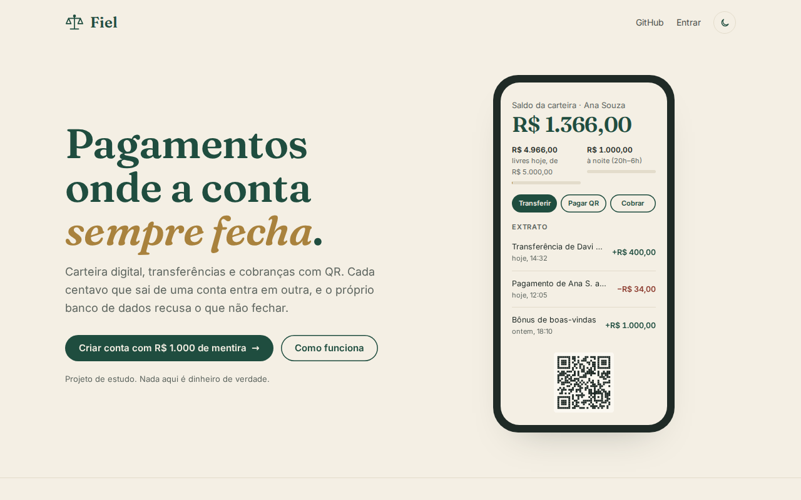
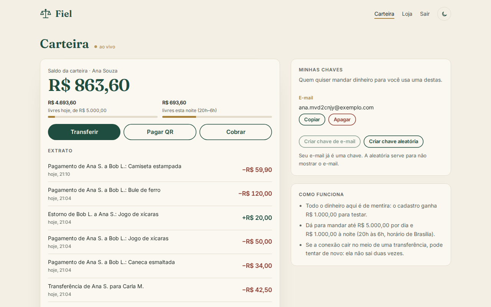
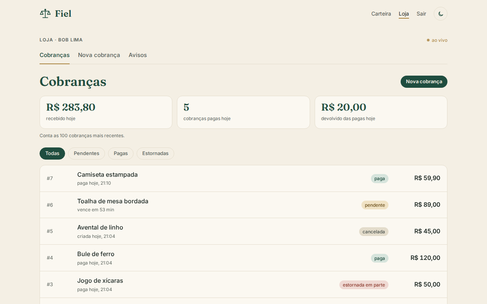
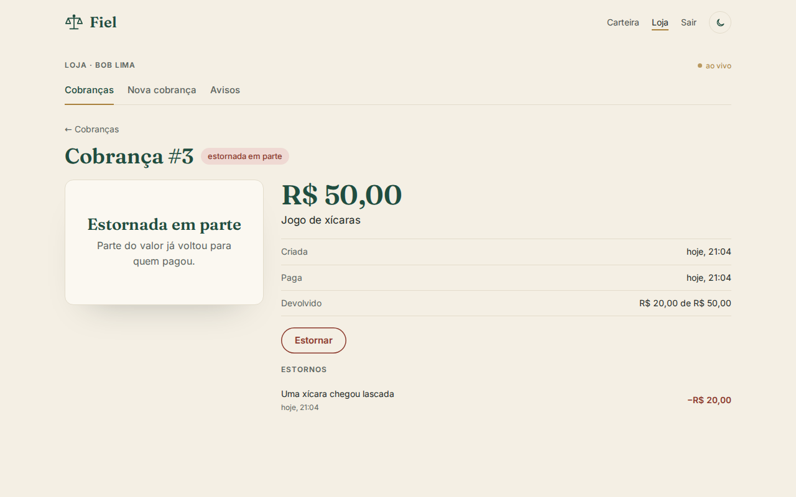
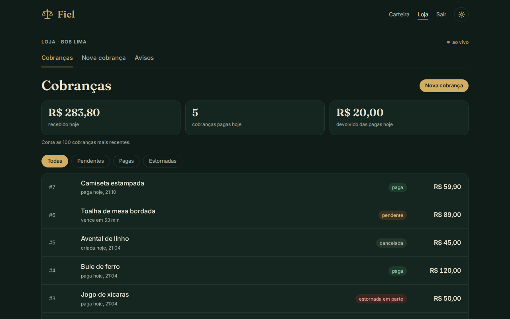
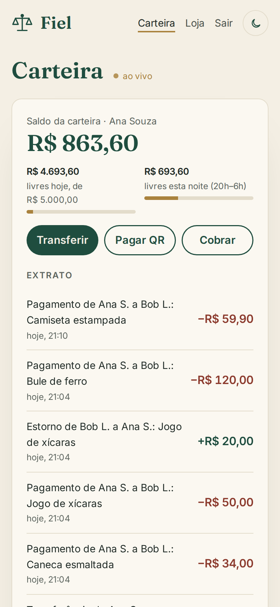

# Fiel

**Fiel · uma plataforma de pagamentos onde a conta sempre fecha.**

[](https://github.com/Lakes777/fiel/actions/workflows/ci.yml)

Carteiras digitais, transferências por chave, cobranças com QR, estornos, avisos para o lojista e
uma conciliação toda noite, com
**dinheiro de mentira**. O nome vem do fiel da balança: cada centavo que sai de uma conta entra
em outra, e o próprio banco de dados recusa um lançamento que não feche em zero.

É o meu primeiro projeto em **Kotlin**.

> Projeto de estudo. Não movimenta dinheiro de verdade, não usa CPF nem dado real, e o QR tem
> formato próprio, de propósito incompatível com aplicativos de banco.


## Fases

- [x] **1. Esqueleto:** Kotlin + Spring Boot 4, Gradle (Kotlin DSL), PostgreSQL 17 com Flyway, `/saude`, erros no formato RFC 9457, testes com Testcontainers, ktlint e detekt no CI
- [x] **2. Razão contábil:** partidas dobradas, valores em centavos (`Long`), lançamentos imutáveis e soma zero conferida pelo banco; testes de propriedade
- [x] **3. Usuários e chaves:** Spring Security com sessão no Postgres e CSRF, cada um só enxerga as próprias contas
- [x] **4. Transferências:** `Idempotency-Key`, saldo nunca negativo, limite diário e noturno, teste com 100 transferências simultâneas
- [x] **5. Cobranças com QR:** formato TLV com CRC16, estados e expiração
- [x] **6. Avisos ao lojista (webhooks):** outbox, novas tentativas com espera crescente, assinatura HMAC com carimbo de tempo, fila de falhas
- [x] **7. Estorno e conciliação noturna:** só quem recebeu devolve (total ou em partes, sem prazo); conferência do razão inteiro toda noite, com aviso no Telegram
- [x] **8. Interface:** React 19 + Vite com identidade própria ("Balança", claro e escuro): tela inicial, carteira e painel do lojista, tudo ao vivo pelo `GET /eventos`
- [ ] **9. Publicação:** demonstração no ar

## Razão contábil

Todo dinheiro vive num livro-razão de **partidas dobradas**. Um *lançamento* é um fato ("Ana
pagou R$ 10,50 à Loja"); cada *partida* diz quanto ele muda o saldo de uma conta (positivo entra,
negativo sai). O saldo de uma conta é a soma das partidas dela. Ele fica guardado na conta para
ler rápido, mas só um gatilho das partidas mexe nele (veja [Transferências](#transferências)), e
os testes de propriedade conferem que ele bate com a soma.

| Ana paga R$ 10,50 à Loja | Conta | Valor (centavos) |
| --- | --- | --- |
| partida 1 | Ana | -1050 |
| partida 2 | Loja | +1050 |
| **soma** | | **0** |

As regras valem **dentro do Postgres** (gatilhos em
[`V1__razao_contabil.sql`](src/main/resources/db/migration/V1__razao_contabil.sql)), não só no
Kotlin, então nem um bug na API nem um SQL escrito à mão as quebram (para qualquer usuário do
banco que não seja o dono das tabelas: o dono pode desligar gatilhos, e por isso a API em produção
usa um usuário sem esse poder, veja [Usuário da API](#usuário-da-api)):

1. **As partidas de um lançamento somam zero.** Conferido no `COMMIT` por um gatilho *deferido*:
   no meio da transação a soma ainda não fecha, e tudo bem; se não fechar no fim, nada é gravado.
2. **Pelo menos duas partidas, em contas diferentes.**
3. **Nada muda nem some:** `UPDATE`, `DELETE` e `TRUNCATE` são recusados. Erro se corrige com um
   lançamento novo, como na contabilidade de verdade.
4. **Lançamento fechado não ganha partida nova.** Sem esta regra, um par +X/−X somado a um
   lançamento antigo manteria a soma zero e criaria dinheiro em uma conta. Cada lançamento guarda
   a transação que o criou (`pg_current_xact_id()`), e só ela pode pôr partidas nele.
5. **Ninguém escolhe id, data nem transação.** O banco recusa id escolhido à mão (que mudaria a
   ordem do histórico) e carimba ele mesmo a data e a transação de cada lançamento.

Os valores são `bigint` em centavos (nada de ponto flutuante com dinheiro). No Kotlin viram um
tipo próprio, `Centavos`, que estoura com erro em vez de dar a volta.

**Testes de propriedade** ([kotest-property](https://kotest.io/docs/proptest/property-based-testing.html)):
sequências aleatórias de lançamentos contra o Postgres de verdade, conferindo cada saldo com uma
conta feita à parte, e centenas de lançamentos que não fecham, escritos direto em SQL, que o banco
precisa recusar. Cada regra foi conferida com uma contraprova: desligada de propósito, algum teste
quebra.

## Usuário da API

O **dono** das tabelas pode o que nenhum gatilho impede: `ALTER TABLE ... DISABLE TRIGGER`, `DROP`,
`TRUNCATE`, trocar uma função. Por isso a API não é dona de nada. Em produção:

- as migrações rodam **à parte**, com o dono ([`Migrar.kt`](src/main/kotlin/io/github/lakes777/fiel/Migrar.kt)),
  e a senha dele nunca entra no contêiner da API (`FIEL_MIGRAR_NA_PARTIDA=false`). Em produção é
  sempre ele quem migra: ele exige o nome do usuário da API, e a V8 roda uma vez só;
- a API entra com um usuário que só lê e grava linhas
  ([`V8__papel_da_api.sql`](src/main/resources/db/migration/V8__papel_da_api.sql)). Mudar saldo à
  mão e apagar lançamento seguem barrados pelos gatilhos, também para ele.

**Tabela temporária.** Qualquer usuário do Postgres podia criar tabela temporária, e na busca por
nome ela vem antes da tabela real. Um `create temp table partida` com duas linhas que somam zero
enganava o gatilho que confere o lançamento, e uma partida só criava dinheiro do nada (achado na
revisão desta fase, reproduzido com o usuário da API). A V8 fecha por dois lados: tira de todos a
permissão de criar tabela temporária e faz toda função procurar primeiro no `public`
(`set search_path = public, pg_temp`). Um teste confere que **toda** função do esquema tem isso,
inclusive as de migrações futuras.

Todos os testes rodam assim: as migrações com o dono e a API com o usuário restrito. O
`PapelDaApiTest` entra com o login dele e confere que tudo o que desligaria as regras é recusado
(contraprova: liberar `TRUNCATE` na V8 faz o teste quebrar).

## Usuários, login e chaves

Cada pessoa tem uma **carteira**. No cadastro, a conta **Emissão** do sistema paga R$ 1.000,00 de
mentira a ela, num lançamento normal do razão: a soma de todo o sistema continua zero, e o saldo
da Emissão é sempre menos todo o dinheiro em circulação.

**Login por sessão, não por JWT.** O login devolve um cookie `FIEL_SESSAO` (HttpOnly, SameSite
Strict, só HTTPS) com o id de uma sessão guardada no Postgres (Spring Session JDBC). Por isso dá
para **sair de verdade**: `DELETE /sessao` apaga a sessão na hora, e `DELETE /sessoes` derruba
todos os aparelhos. Um JWT continuaria valendo até vencer.

Como o navegador manda o cookie sozinho, todo pedido que muda algo exige também o **token CSRF**
(cookie `XSRF-TOKEN`, devolvido no cabeçalho `X-XSRF-TOKEN`), que um site de fora não consegue
ler. Vale até para o login, senão um site poderia logar você na conta dele.

| Proteção | Como |
| --- | --- |
| Senha | bcrypt (`{bcrypt}` no hash, dá para trocar de algoritmo depois); de 10 caracteres a 72 bytes, o limite do bcrypt, em vez de cortar sem aviso |
| Força bruta | 5 tentativas de login por e-mail a cada 15 min (429 com `Retry-After`), contadas **antes** de conferir a senha: 20 pedidos ao mesmo tempo ainda testam só 5 senhas (um teste conta as conferências do bcrypt). Senha certa zera a contagem |
| Quem tem conta | No login, senha errada e e-mail sem cadastro dão a mesma resposta, no mesmo tempo. **O cadastro ainda revela** (409 para e-mail já usado); o certo é confirmar por e-mail, que o projeto não manda. Por isso o cadastro tem limite: 10 por hora por IP |
| Fixação de sessão | O id da sessão e o token CSRF mudam no login |
| Sessão esquecida aberta | 15 min sem uso de verdade e a sessão acaba. A tela ao vivo reconecta sozinha, e isso **não** conta como uso: um filtro guarda a hora do último pedido que não seja `/eventos`, e a conexão ao vivo fecha quando a sessão vence |
| Conta de outra pessoa | **Autorização por objeto:** a conta (ou chave) de outra pessoa responde 404, igual a uma que não existe |
| Varredura de chaves | 30 consultas por minuto por usuário; a consulta mostra só "Ana S." |
| A sessão no banco | Guarda o usuário sem o hash da senha |

**Chaves** são apelidos para a carteira: o **e-mail do próprio dono** (ninguém cadastra o e-mail de
outra pessoa para receber no lugar dela) e **aleatórias** (UUID). Nada de CPF ou telefone. No
máximo 5 por conta.

Como no razão, as regras que importam também estão **no banco**
([`V2__usuarios_e_chaves.sql`](src/main/resources/db/migration/V2__usuarios_e_chaves.sql)): o dono
e o tipo de uma conta nunca mudam (trocar o dono seria mover o dinheiro sem lançamento), só
carteira tem dono, uma por pessoa, o e-mail de um usuário não muda, e o limite de 5 chaves vale
mesmo com duas criadas ao mesmo tempo, em qualquer nível de isolamento: a conta guarda um
contador de chaves (com `check` de 0 a 5) que só os gatilhos mexem. Duas inserções simultâneas
atualizam a mesma linha, então uma espera a outra. Um `count(*)` com `for update` (a primeira
versão) falhava em `REPEATABLE READ`, onde a contagem enxerga a "foto" do começo da transação; os
testes seguram uma transação aberta nos dois níveis para provar que a segunda não passa.

| Rota | O que faz |
| --- | --- |
| `GET /csrf` | Entrega o token CSRF (chamar antes do primeiro POST) |
| `POST /cadastro` | `{nome, email, senha}`: cria usuário, carteira e bônus |
| `POST /sessao` | `{email, senha}`: entra |
| `GET /eu` | Quem está logado |
| `DELETE /sessao` / `DELETE /sessoes` | Sai deste aparelho / de todos |
| `GET /contas` | Minhas contas, com saldo em centavos |
| `GET /contas/{id}/extrato?limite=50` | Extrato, mais recente primeiro, com o saldo depois de cada movimento |
| `GET /chaves`, `POST /chaves` `{tipo}`, `DELETE /chaves/{id}` | Minhas chaves (`email` ou `aleatoria`) |
| `POST /chaves/consulta` `{valor}` | De quem é a chave ("Ana S."); POST para a chave não ir parar na URL |

## Transferências

`POST /transferencias` com `{chave, valorCentavos}` manda dinheiro da carteira de quem está logado
para a carteira dona da chave. A resposta mostra o recebedor só como "Bob L.".

**`Idempotency-Key` obrigatória.** Se a rede cai depois do envio, o app não sabe se a
transferência foi feita e manda de novo. Com a mesma chave, a API devolve a **mesma**
transferência (cabeçalho `Idempotent-Replayed: true`), sem cobrar duas vezes. A mesma chave com
outro pedido (outro valor, outro recebedor) é recusada com 422. Vinte cópias do mesmo pedido
mandadas ao mesmo tempo fazem uma transferência só: a chave é travada com
`pg_advisory_xact_lock` e as cópias esperam a primeira terminar. A chave vale por usuário, e uma
transferência recusada (saldo, limite) não fica guardada, então repetir tenta de novo.

**Ninguém gasta o mesmo dinheiro duas vezes.** Dentro de uma transação, as duas contas são
travadas (`SELECT ... FOR UPDATE`) **sempre em ordem de id**, e só então saldo e limites são
conferidos. Ana -> Bob e Bob -> Ana ao mesmo tempo travam na mesma ordem: uma espera a outra, sem
deadlock. Testes: 100 transferências simultâneas de R$ 15 com R$ 1.000 de saldo dão exatamente 66
aceitas e 34 recusadas; 60 cruzadas entre Ana e Bob terminam todas, com os saldos de volta ao
começo.

**O banco é a última palavra** ([`V4__transferencias.sql`](src/main/resources/db/migration/V4__transferencias.sql)):

- o saldo fica guardado na conta, e só o gatilho das partidas mexe nele. Ler o saldo deixou de
  ser uma soma de todo o histórico, e os testes de propriedade conferem que ele bate com a soma;
- `check (saldo >= 0)` em toda carteira: nem um lançamento escrito à mão no razão deixa uma
  carteira negativa. Na contraprova (sem a trava da aplicação), as 100 simultâneas deram 500 em
  algumas, mas nenhum centavo a mais saiu;
- conta nasce com saldo zero: um INSERT à mão não cria carteira com dinheiro que o razão não conhece;
- a transferência confere o próprio lançamento (mesmas contas, mesmo valor, nada mais), no
  **commit**, para nem uma partida acrescentada depois passar; sai só da carteira de quem pediu e
  nunca muda nem é apagada.

**Limites**, no horário de Brasília, como a regra do Banco Central para a noite:

| Período | Limite |
| --- | --- |
| Por dia (a partir da meia-noite) | R$ 5.000,00 |
| À noite (20h às 6h, atravessando a meia-noite) | R$ 1.000,00 |

Os dois valem ao mesmo tempo; a mensagem do 422 diz qual estourou e quanto ainda dá para mandar.
`GET /limites` mostra à tela, antes de a pessoa tentar, quanto já saiu no dia e na noite e quanto
ainda dá para mandar agora.
A hora vem de um `Clock` injetado: os testes param o relógio às 23h, à 1h, às 6h. Também há um
limite de 30 pedidos por minuto por usuário, para transferências de 1 centavo não servirem para
varrer chaves.

**Risco aceito: juntar bônus.** Cada cadastro ganha R$ 1.000, e com transferências dá para criar
contas e mandar tudo para uma só. O freio é o limite de 10 cadastros por hora por IP. Um banco de
verdade fecharia a porta com verificação de identidade, que este projeto não faz de propósito
(nada de CPF nem dado real). Travar o bônus só para pagamentos não resolveria: o dinheiro sairia
pela cobrança de uma "loja" da mesma pessoa.

| Status | Quando |
| --- | --- |
| 201 | Feita (ou repetida, com `Idempotent-Replayed`) |
| 400 | Sem `Idempotency-Key`, valor zero ou negativo, chave da própria carteira |
| 404 | Chave que não existe |
| 422 | Saldo insuficiente, limite passado, `Idempotency-Key` já usada em outro pedido |
| 429 | Mais de 30 pedidos por minuto |

## Cobranças com QR

Qualquer pessoa com carteira pode cobrar: `POST /cobrancas` com `{valorCentavos, descricao,
validadeMinutos}` (de 1 minuto a 1 dia; padrão 30) devolve a cobrança com o texto do **QR**. Quem
paga manda esse texto em `POST /pagamentos/consulta` para conferir (valor, descrição, "Bob L.")
e em `POST /pagamentos` para pagar.

**O QR** segue a ideia dos QR de pagamento de verdade (EMV): uma fila de campos TLV (ID de 2
dígitos, tamanho de 2 dígitos, valor) terminando num **CRC16/CCITT-FALSE**. O formato é próprio e
**incompatível com app de banco de propósito**: o primeiro campo é `FIEL`, não o `01` do padrão.

```
00 04 FIEL                                   formato
01 01 1                                      versão
26 36 3f2a9c1e-7b4d-4e8a-9f60-1c2d3e4f5a6b   código da cobrança (aleatório: ninguém adivinha contando)
54 04 2550                                   valor em centavos
59 06 Bob L.                                 recebedor
63 04 xxxx                                   CRC16 de tudo antes, incluindo o "6304"
```

O CRC pega erro de leitura: um teste troca cada caractere de um QR, um por vez, e nenhuma troca
passa. Ele **não** é segurança, porque qualquer um recalcula. Por isso quem paga vê os dados do
servidor, não os do QR, e um QR com outro valor impresso é recusado (422).

**Paga uma vez só, sem Idempotency-Key.** A idempotência é natural: a cobrança é travada (`FOR
UPDATE`) antes de tudo. Quem já pagou e manda de novo recebe o mesmo pagamento
(`Idempotent-Replayed`); outra pessoa recebe 409. Teste: 20 pessoas pagando a mesma cobrança ao
mesmo tempo, 1 paga e 19 levam 409; a mesma pessoa mandando 20 vezes paga uma.

**Estados**, que o banco só deixa andar para a frente
([`V5__cobrancas.sql`](src/main/resources/db/migration/V5__cobrancas.sql)):

```
pendente ──► paga ──► parcialmente_estornada ──► estornada
    │         └──────────────────────────────────────► (estorno de tudo de uma vez)
    ├──────► expirada
    └──────► cancelada   (POST /cobrancas/{id}/cancelamento, só o lojista)
```

Os estados de estorno não se escrevem à mão: só o gatilho do estorno leva até eles (veja
[Estornos](#estornos)).

O que foi cobrado (valor, recebedor, datas) nunca muda; o pagamento gravado também não; o
lançamento do pagamento é conferido no commit (mesmas contas, mesmo valor, nada mais); cobrança
não é apagada.

**Expiração por tarefa agendada**, a cada minuto, só para arrumar o estado guardado. Quem decide
se ainda dá para pagar é a **hora**, conferida no pagamento: com a tarefa atrasada (ou desligada,
como nos testes), uma cobrança vencida já aparece como `expirada` e não é paga.

**Pagamento conta nos limites** diário e noturno junto com as transferências: separados, daria
para mandar R$ 1.000 de madrugada por transferência e esvaziar o resto pagando cobranças.

| Rota | O que faz |
| --- | --- |
| `POST /cobrancas` | Cria; devolve `qr` |
| `GET /cobrancas`, `GET /cobrancas/{id}` | As minhas (as 100 mais recentes) / uma; a de outro lojista é 404 |
| `POST /cobrancas/{id}/cancelamento` | Cancela uma pendente |
| `POST /pagamentos/consulta` `{qr}` | O que vou pagar, com dados do servidor |
| `POST /pagamentos` `{qr}` | Paga |

## Avisos ao lojista (webhooks)

O lojista cadastra um endereço (`PUT /webhook {url}`) e o Fiel avisa o sistema dele quando uma
cobrança é paga, expira ou é estornada, ou quando chega uma transferência (`cobranca.paga`,
`cobranca.expirada`, `cobranca.estornada`, `transferencia.recebida`). A resposta do cadastro traz o **segredo** da
assinatura, que não aparece de novo.

**Outbox.** O aviso é gravado **na mesma transação** do fato. Pagou, o aviso existe; o pagamento
desfez (saldo, limite), o aviso some junto. Não há janela em que o dinheiro mudou e o aviso se
perdeu, nem aviso de um pagamento que não aconteceu. Um teste confere os dois lados.

**Entrega**, por uma tarefa que roda a cada 2 s, sem segurar transação aberta esperando a rede:

1. reserva um lote de 10 com `FOR UPDATE SKIP LOCKED` e empurra a próxima tentativa para depois
   do pior caso do lote inteiro (10 × o prazo de envio, mais 1 minuto). Outra instância pula o que
   está reservado, e um aviso de uma instância que morreu no meio volta sozinho quando a reserva
   vence. Teste: 5 entregadores ao mesmo tempo, 30 avisos, cada um chega **uma vez** (com um
   receptor que responde rápido). Na contraprova (sem `SKIP LOCKED`), chegam repetidos;
2. manda, **sem seguir redirecionamento** e com **prazo de 15 s para o envio inteiro**, inclusive o
   corpo da resposta, que é descartado sem ler. O tempo máximo comum do cliente HTTP só vale até os
   cabeçalhos: um lojista que mandasse a resposta 1 byte por vez prenderia a entrega de todo mundo
   (teste: sem o prazo total, o envio levou 60 s). As tarefas agendadas têm 2 threads, para a
   expiração das cobranças não esperar uma entrega lenta;
3. 2xx é entregue. Qualquer outra resposta, falha de rede ou erro, tenta de novo com **espera
   crescente**: 30 s, 1 min, 2 min... até 1 h, com até 20% ao acaso, para mil avisos que falharam
   juntos não voltarem todos no mesmo segundo. Depois de 8 tentativas, vai para a **fila de
   falhas** (`GET /avisos?estado=falhou`), e `POST /avisos/{id}/reenvio` manda de novo.

**Assinatura**, no desenho do Stripe:

```
Fiel-Evento: cobranca.paga
Fiel-Evento-Id: 3f2a9c1e-7b4d-4e8a-9f60-1c2d3e4f5a6b
Fiel-Assinatura: t=1760652000,v1=<HMAC-SHA256 de "t.corpo" com o segredo, em hexadecimal>
```

O HMAC prova a origem e que o corpo não mudou; o `t` deixa o lojista recusar um aviso velho
capturado e reenviado. A entrega é **pelo menos uma vez**: se a resposta do lojista se perde, o
aviso vai de novo, com o mesmo `id`, para ele descartar. A ordem de chegada também não é garantida
(um aviso que falhou chega depois de um mais novo): o lojista olha o `criadoEm` e o estado atual,
não a ordem.

**Lojista exemplo:** [`exemplos/lojista.py`](exemplos/lojista.py), só com a biblioteca padrão do
Python. Confere a assinatura em tempo constante, recusa aviso com mais de 5 minutos e descarta
repetidos pelo `id` de **dentro do corpo**, que a assinatura cobre. O cabeçalho `Fiel-Evento-Id`
não é assinado: quem capturasse um aviso poderia reenviá-lo com outro id no cabeçalho.

**SSRF.** O Fiel faz um pedido para uma URL escolhida pelo usuário. Sem cuidado, alguém cadastraria
`http://169.254.169.254/` (os metadados da nuvem, com as credenciais da máquina) ou
`http://localhost:5432` e usaria o Fiel para sondar a rede de dentro. Por isso o endereço precisa
ser `https`, sem usuário e senha, com porta válida, e **todo IP** para onde o nome aponta precisa
ser público: recusa loopback, redes privadas, link-local, CGNAT, multicast, reservados (`0/8`,
`198.18/15`, `240/4`), IPv6 local e IPv4 escondido dentro de IPv6 (`::ffff:`, `::a.b.c.d`, NAT64,
6to4). O histórico guarda só o status HTTP da resposta, nunca o corpo: se algo um dia passasse
pela conferência, o Fiel não viraria um leitor da rede interna. A conferência é feita
no cadastro e antes de cada envio, e o redirecionamento não é seguido, porque um 3xx levaria o
pedido a um endereço não conferido. Sobra uma janela pequena: o DNS pode mudar entre a conferência e
a conexão (*DNS rebinding*). Fechar de vez exigiria conectar no IP conferido.

**Risco anotado: o segredo fica em claro no banco.** O Fiel precisa dele para assinar (um hash não
serviria, ao contrário de uma senha). Quem vazasse um backup poderia forjar avisos para todos os
lojistas. A defesa seria cifrar a coluna (AES-GCM, com a chave numa variável de ambiente).

| Rota | O que faz |
| --- | --- |
| `PUT /webhook` `{url}` | Cadastra ou troca o endereço; devolve o segredo (novo a cada troca) |
| `GET /webhook`, `DELETE /webhook` | Vê ou apaga; apagar manda os pendentes para a fila de falhas |
| `GET /avisos?estado=` | Histórico de entregas (100 mais recentes); `falhou` é a fila de falhas |
| `POST /avisos/{id}/reenvio` | Manda de novo um entregue ou que falhou, com as tentativas do zero |

## Estornos

Quem recebeu uma cobrança devolve o dinheiro a quem pagou, tudo ou em partes, sem prazo:
`POST /cobrancas/{id}/estornos` com `{valorCentavos, motivo}` (motivo opcional, até 140
caracteres). O estorno é um **lançamento novo**, da carteira do lojista para a do pagador: o
pagamento original continua no razão, como na contabilidade de verdade.

**Só o lojista estorna.** Quem pagou não tem rota para pedir a devolução, e o projeto não tem
contestação (o MED do Pix, em que o banco de quem pagou pede o dinheiro de volta por fraude). Isso
exigiria um segundo lado com regras próprias (prazos, bloqueio cautelar do valor, análise), e
ficou de fora de propósito.

**`Idempotency-Key` obrigatória**, como na transferência, e válida por cobrança: o app que repete
o pedido depois de uma queda de rede não devolve duas vezes. A cobrança é travada (`FOR UPDATE`)
antes de tudo, então 20 cópias do mesmo pedido ao mesmo tempo fazem um estorno só, e 20 estornos
diferentes de R$ 2 numa cobrança de R$ 10 passam exatamente 5.

**Um detalhe do Postgres que o revisor pegou:** a soma dos estornos é lida num comando separado,
**depois** da trava. Quando o `SELECT ... FOR UPDATE` espera outra transação soltar a cobrança, ele
devolve a linha nova da cobrança, mas uma subconsulta dentro dele continua com a foto de antes da
espera (em `READ COMMITTED`). Com a soma junto no mesmo SELECT, dois estornos de R$ 3 ao mesmo tempo
mandavam ao lojista dois avisos dizendo "R$ 3 estornados", em vez de R$ 3 e R$ 6. O teste disso
quebra na contraprova. A ordem das travas é a mesma do
pagamento (cobrança e depois contas), então estorno e pagamento nunca se esperam em círculo.

**Limites: o estorno fica fora dos dois lados.**

| Pergunta | Resposta | Por quê |
| --- | --- | --- |
| Conta no limite de quem devolve? | Não | Um lojista que já usou o limite da noite ainda devolve o dinheiro do cliente. Não há risco: só dá para devolver o que entrou, e só para quem pagou |
| Devolve o limite de quem pagou? | Não | Senão pagar, receber o estorno e pagar de novo giraria acima do limite diário, com uma "loja" da mesma pessoa |

**O banco é a última palavra** ([`V7__estornos_e_conciliacao.sql`](src/main/resources/db/migration/V7__estornos_e_conciliacao.sql)):

- só cobrança paga (ou estornada em parte) recebe estorno, e a soma dos estornos nunca passa do
  valor. O gatilho trava a cobrança antes de somar, então dois estornos ao mesmo tempo também não
  passam. Na contraprova, sem a trava da aplicação, os mesmos 20 pedidos simultâneos ainda deram
  exatamente 5 estornos (os outros voltaram 500 em vez de 409/422): o banco segurou o dinheiro
  sozinho;
- o estado da cobrança segue a soma dos estornos, e só o gatilho do estorno o muda. Um `UPDATE`
  à mão para `estornada` é recusado, como o saldo guardado da conta;
- o lançamento do estorno é conferido no commit (do lojista para o pagador, exatamente o valor).
  Um lançamento é de um fato só: o de um estorno não serve de transferência nem de pagamento, e
  vice-versa;
- estorno não muda nem é apagado.

| Status | Quando |
| --- | --- |
| 201 | Feito (ou repetido, com `Idempotent-Replayed`) |
| 400 | Sem `Idempotency-Key`, valor zero ou negativo, motivo longo demais |
| 404 | Cobrança que não existe ou de outro lojista (inclusive para quem pagou) |
| 409 | Cobrança pendente, expirada, cancelada ou já estornada por inteiro |
| 422 | Mais do que falta devolver, saldo insuficiente, `Idempotency-Key` já usada em outro pedido |

| Rota | O que faz |
| --- | --- |
| `POST /cobrancas/{id}/estornos` | Estorna; `GET /cobrancas/{id}` passa a mostrar `estornadoCentavos` |
| `GET /cobrancas/{id}/estornos` | Os estornos da cobrança, do mais antigo ao mais novo |

## Conciliação noturna

Toda noite, às 3h de Brasília, uma tarefa refaz com SQL as contas que os gatilhos já garantem uma
a uma, olhando o sistema inteiro:

1. todas as partidas somam zero (dinheiro não nasceu nem sumiu);
2. cada lançamento fecha em zero, com pelo menos duas partidas;
3. o saldo guardado de cada conta é a soma das partidas dela;
4. nenhuma carteira está negativa;
5. cada transferência, pagamento e estorno bate com o próprio lançamento;
6. o estado de cada cobrança combina com a soma dos estornos dela, e cobrança não paga não tem estorno;
7. nenhum lançamento é de dois fatos ao mesmo tempo;
8. **todo dinheiro que entra numa carteira tem um fato por trás**: transferência, pagamento,
   estorno ou o bônus do cadastro (um por carteira). Um lançamento balanceado da emissão para uma
   carteira passa por todos os gatilhos (a soma fecha, o saldo bate) e só esta conferência o pega.
   No banco dos testes ela acusa, corretamente, os "depósitos de teste" que alguns testes fazem
   para ter saldo de sobra.

**Para que conferir o que os gatilhos já impedem?** Os gatilhos barram o erro na entrada. A
conciliação acha o que entrou **por fora** deles: o dono das tabelas pode desligar gatilhos, um
backup pode ser restaurado pela metade, uma migração pode ter bug. Melhor descobrir às 3h, pela
conferência, do que pela reclamação de um cliente. Os testes provam cada conferência do jeito
difícil: desligam os gatilhos (`session_replication_role = replica`), estragam o banco dentro de
uma transação, conferem e desfazem.

Tudo roda numa transação `REPEATABLE READ` e só de leitura: as conferências veem a mesma foto do
banco, então um pagamento feito no meio não aparece numa soma e falta na outra. O resultado fica
na tabela `conciliacao`, **um por dia**: com duas instâncias da API, a segunda encontra o dia
ocupado e não manda o aviso de novo.

O resultado vai para um chat do **Telegram** (`FIEL_TELEGRAM_TOKEN` e `FIEL_TELEGRAM_CHAT`):

```
Fiel · conciliação de 17/10/2026
Tudo fecha: 1.284 lançamentos, R$ 52.310,00 em carteiras.
Últimas 24 h: 12 transferência(s) (R$ 830,00), 4 pagamento(s) (R$ 215,50), 1 estorno(s) (R$ 25,50).
```

Com divergência, a mensagem começa com `ATENÇÃO` e lista as 10 primeiras (cada conferência traz as
mais novas primeiro). Se o Telegram estiver fora do ar, a mensagem fica pendente (`avisada_em`
nula) e uma tarefa tenta de novo a cada 5 minutos, por até 7 dias. Sem token configurado, o
resultado fica só no log. O token vai na URL da API do Telegram, então nada no Fiel loga a URL
nem a mensagem de erro do envio.

## Ao vivo (`GET /eventos`)

A tela abre `new EventSource("/eventos")` (Server-Sent Events) e fica sabendo, sem perguntar de
tempos em tempos, quando algo dela muda: `carteira` (saldo e extrato), `cobranca` (com o id) e
`avisos` (uma entrega de webhook terminou). O evento **não leva dados**, só "busque de novo": a tela
busca pelas rotas de sempre, que já conferem quem pode ver o quê. Ao abrir (e a cada reconexão)
chega `pronto`, e a tela busca tudo, para não perder o que mudou enquanto estava desconectada.

**Pelo próprio Postgres, com `LISTEN`/`NOTIFY`.** Cada fato (transferência, pagamento, estorno,
cobrança criada, cancelada ou expirada) faz um `pg_notify` **dentro da sua transação**. O Postgres só
entrega o `NOTIFY` no commit: um pagamento desfeito (saldo, limite) não avisa ninguém, e o aviso
nunca chega antes de o dado estar gravado. Toda instância da API escuta o canal numa conexão só
dela, então o evento chega a quem estiver conectado em qualquer instância, sem Redis.

| Cuidado | Como |
| --- | --- |
| Evento de outra pessoa | O `NOTIFY` leva o id do dono da conta, e cada conexão só recebe os do usuário dela (teste com três pessoas) |
| Conexão do `LISTEN` caiu | Volta sozinha, com espera crescente, e manda `pronto` a todas as telas (teste derruba a conexão com `pg_terminate_backend`). Sem aviso por 30 s, um `select 1` confere se ela ainda está viva: firewall de nuvem derruba conexão parada sem avisar |
| `NOTIFY` estragado | É ignorado, sem derrubar o `LISTEN` |
| Muitas abas | No máximo 5 conexões por pessoa; a mais antiga fecha |
| Celular que não lê | Cada envio roda numa thread virtual: um cliente travado não atrasa os outros |
| Proxy que fecha conexão parada | Um comentário (`ping`) a cada 25 s |
| Desligar a API | As conexões fecham antes do desligamento gracioso, que senão esperaria por elas 20 s (medido: 1 s) |
| Sair | `DELETE /sessao` e `DELETE /sessoes` fecham as conexões da pessoa |

## Interface

React 19 + Vite + TypeScript, em `web/`, com a identidade "Balança": papel marfim, tinta
verde-garrafa e latão, números em Fraunces e o resto em Inter, e o logo é uma balança com o fiel
no meio. O tema escuro troca o marfim por verde-garrafa e o latão vira a cor dos botões; a primeira
visita segue o aparelho, e o botão da lua lembra a escolha.

**Tela inicial.** Um celular com a carteira de exemplo, montada com o mesmo componente da carteira
de verdade: o saldo conta até o valor, o extrato surge linha a linha e o QR se desenha. Embaixo, os
recursos e um lançamento que soma R$ 0,00.

**Carteira.** Saldo, os limites do dia e da noite com o quanto ainda dá para mandar, o extrato, as
chaves e três caminhos: transferir (chave, depois o nome do dono para conferir, valor e
confirmação), pagar um QR (cola o código, confere valor e recebedor, paga) e cobrar.

**Painel do lojista.** O resumo do dia (recebido, cobranças pagas, devolvido), as cobranças com
filtro por estado, o detalhe com o QR, cancelar e estornar (total ou em partes, com motivo), e os
avisos do webhook com reenvio.

**Ao vivo.** Cada tela ouve o `GET /eventos` e busca de novo só o que mudou: o lojista vê a cobrança
virar "paga" no instante em que alguém paga, e o saldo de quem recebe conta até o valor novo.

O que a tela faz para não dar errado com dinheiro:

| Situação | O que acontece |
| --- | --- |
| Queda de rede (ou 502/504) no meio de uma transferência ou estorno | A mesma `Idempotency-Key` vai na nova tentativa, e o servidor não faz duas vezes; a chave só muda depois de dar certo |
| A cobrança mudou entre conferir e pagar (409) | "A cobrança mudou enquanto você conferia. Nada foi pago.", e a tela consulta de novo para mostrar o estado real |
| Trocar o código depois de conferir | O campo trava enquanto paga, e uma resposta atrasada de uma consulta antiga é descartada: paga-se sempre o QR que foi conferido |
| Sessão vencida (15 min sem uso) no meio de um pedido | Volta para entrar, e depois do login retorna à mesma tela, sem repetir o pedido |
| Valor digitado como `12.50` | Lido como R$ 12,50; o ponto só vale como milhar em grupos de três (`1.234`) |
| Recarregar a página logo depois de criar uma cobrança | Não anuncia "Pagamento recebido agora" para um pagamento antigo |
| Pedir menos movimento no sistema | Todas as animações param (contagem, extrato, QR, carimbo) |

| | |
| --- | --- |
|  |  |
|  |  |
|  |  |

## Rodando

Precisa do Java 21 e do Docker.

```bash
docker compose up -d        # Postgres 17 de desenvolvimento (porta 5436)
./gradlew bootRun           # http://localhost:8080/saude
```

Sem o compose, `./gradlew bootTestRun` sobe a API com um Postgres temporário do Testcontainers.

```bash
./gradlew build             # ktlint, detekt e testes
./gradlew ktlintFormat      # corrige o estilo
```

A interface (Node 24, o mesmo do CI), com a API rodando:

```bash
cd web
npm install
npm run dev                 # http://localhost:5190 (o Vite manda /api para a 8080)
npm test                    # Vitest + Testing Library
npm run build               # confere os tipos e gera web/dist
```

## Configuração

| Variável | Padrão (desenvolvimento) | Para quê |
| --- | --- | --- |
| `FIEL_BANCO_URL` | `jdbc:postgresql://localhost:5436/fiel` | Endereço do Postgres |
| `FIEL_BANCO_USUARIO` | `fiel` | Usuário do banco |
| `FIEL_BANCO_SENHA` | `fiel` | Senha do banco |
| `FIEL_PORTA` | `8080` | Porta da API |
| `FIEL_TELEGRAM_TOKEN` | (vazio) | Token do bot que manda a conciliação noturna; vazio = só no log |
| `FIEL_TELEGRAM_CHAT` | (vazio) | Id do chat que recebe a conciliação |

## `/saude`

`GET /saude` responde `200 {"status":"ok","banco":"ok"}` quando a API alcança o banco e
`503 {"status":"erro","banco":"fora do ar"}` quando não alcança, sem mostrar o erro (que pode ter
endereço interno); o motivo vai para o log. Nunca fica em cache (`Cache-Control: no-store`).

Com o banco inalcançável, o 503 pode levar até uns 7 s (até 5 s esperando uma conexão do pool e
2 s para ela responder): um monitor precisa esperar mais do que isso (o Vigil espera 10 s).
